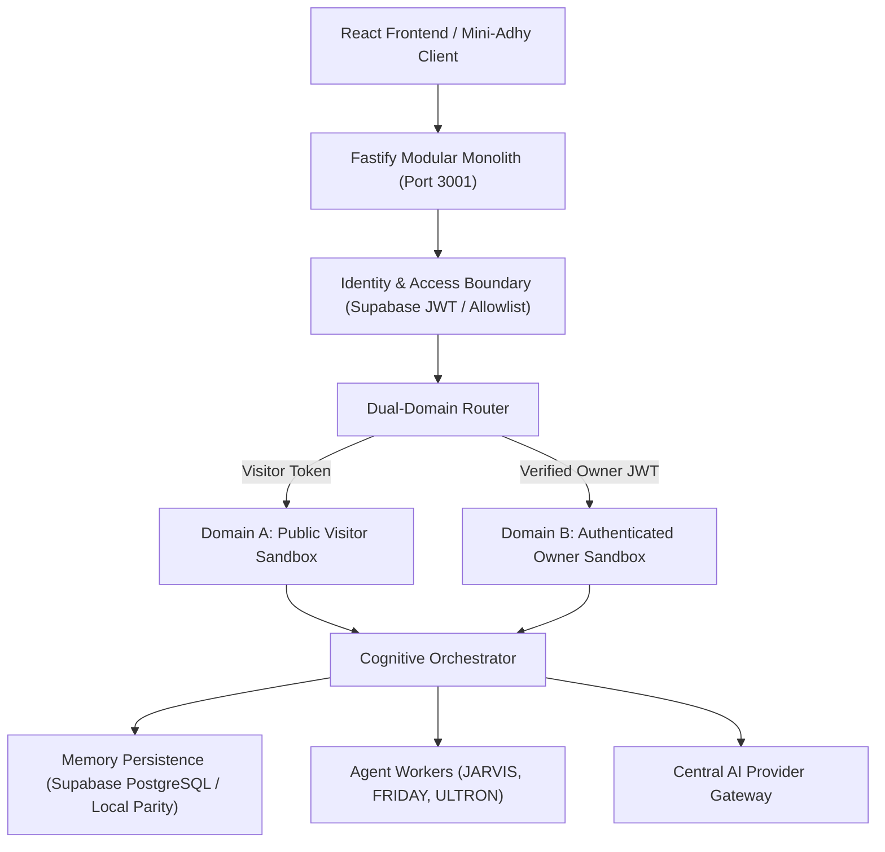

# Mini-Adhy Backend Monolith Architecture

## 1. System Overview

The Mini-Adhy backend is a Fastify + TypeScript high-performance monolithic architecture designed for **Dual-Domain Personal Intelligence** with strict ₹0 budget operational parity.

## 2. Core Subsystems

### A. Modular Fastify Runtime
* **Engine**: Fastify v4 + TypeScript + Zod validation.
* **Security Middleware**: Helmet headers, CORS restricted to `https://adhy.tech` & localhost, 1MB payload limits, prototype pollution sanitization hook, and per-route rate limiting.
* **Observability**: Pino structured logging, unique request correlation IDs (`req_...`), and OpenAPI Swagger UI at `/docs`.

### B. Dual-Domain Isolation
1. **Domain A: Public Visitor (`/api/v1/public/*`)**:
   - Access to published portfolio knowledge and public assistant chat.
   - Isolated visitor sessions (`x-visitor-session-id`) preventing cross-visitor history inspection.
   - Strict zero-access to private memory, personal credentials, computer actuation, or owner dashboard.
2. **Domain B: Authenticated Owner (`/api/v1/owner/*`)**:
   - Server-enforced JWT signature verification against Supabase Auth.
   - Server-controlled owner allowlist (`OWNER_EMAILS=adhithyamohan2312@gmail.com`).
   - Access to private episodic memory, cognitive profile, agent tasks, integration tokens, and approval inbox.

### C. Unified AI Provider Gateway
* **Adapters**: Google Gemini 1.5 Flash, GroqCloud LPU (Llama 3.3 70B), Hugging Face Router, OpenRouter Failover, and local Ollama (`http://127.0.0.1:11434`).
* **Routing Policy**:
  - `STRICT_LOCAL`: Guaranteed to execute only on local Ollama; fails closed rather than leaking private memory to cloud providers.
  - `vision`: Routes to vision-capable models (Gemini).
  - `fast_reflex`: Routes to low-latency LPU inference (Groq).
  - Bounded fallback cascade with circuit breakers and backoff.

### D. Memory Persistence & Lifecycle
* **Categories**: Engineering, projects, preferences, identity, hardware.
* **Provenance**: Source attribution (`USER_INPUT`, `MODEL_INFERENCE`, `EXTERNAL_IMPORT`, `CODEBASE`).
* **Lifecycle**: `IMPORTED` -> `QUARANTINED` -> `REVIEW_REQUIRED` -> `APPROVED` / `REJECTED` -> `ARCHIVED`.
* Unverified inferences are never treated as facts.

