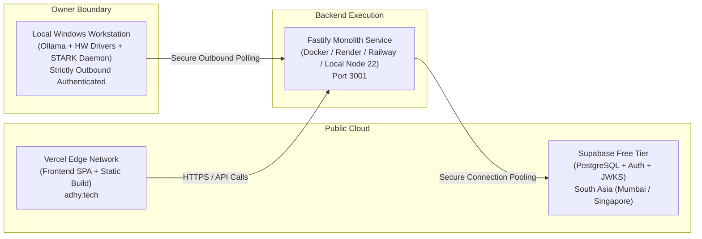

# Mini-Adhy Deployment Architecture (Zero-Budget Parity)

## 1. Hosting Architecture

The deployment architecture adheres to strict **Domain Separation** and **₹0 Budget**:



## 2. Environment Variables & Secret Configuration

### Backend Secrets (`backend/.env` - Server-side Only)
Never prefix server secrets with `REACT_APP_` to prevent bundle leakage.

```bash
# Supabase PostgreSQL & Auth
SUPABASE_URL=https://your-project-id.supabase.co
SUPABASE_PUBLISHABLE_KEY=sb_publishable_your_publishable_key_here
SUPABASE_SECRET_KEY=sb_secret_your_service_role_secret_key_here
SUPABASE_JWKS_URL=https://your-project-id.supabase.co/auth/v1/.well-known/jwks.json

# Identity & Cryptography
OWNER_EMAILS=adhithyamohan2312@gmail.com
ENCRYPTION_SECRET=your_aes_256_gcm_master_key
SESSION_SECRET=your_hmac_sha256_session_secret

# AI Provider Free-Tier Keys (Graceful degradation if absent)
GEMINI_API_KEY=your_gemini_api_key
GROQ_API_KEY=your_groq_api_key
HF_TOKEN=your_huggingface_token
OPENROUTER_API_KEY=your_openrouter_api_key
OLLAMA_BASE_URL=http://127.0.0.1:11434
```

## 3. Database Migration Deployment

To apply database migrations to Supabase:
```bash
# Using Supabase CLI or SQL Editor:
psql $DATABASE_URL -f backend/migrations/001_initial_schema.sql
psql $DATABASE_URL -f backend/migrations/002_domain_separation_schema.sql
```

## 4. Workstation & Local Boundary Protection
- Inbound workstation ports are **never** opened to the public internet.
- Local capabilities (Ollama, hardware actuation) are connected via authenticated outbound queries or isolated local network proxies.

