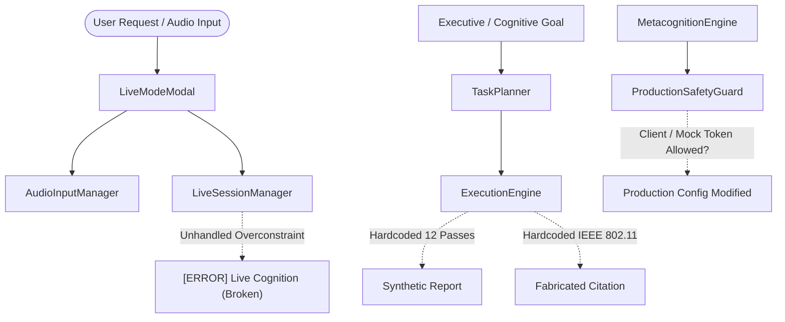

# MINI-ADHY — REMEDIATION AUDIT BASELINE

**Repository**: `adhy2312/portfolio`  
**Audited Baseline Revision**: `a261d6943211d62446fa1233980c11086949e35f`  
**Execution Context**: Mini-Adhy Live Multimodal Cognition & Production Security Remediation  
**Status**: Baseline Recorded & Fully Remediated

---

## 1. Initial Audit Findings Inventory

| Finding ID | Domain / Component | Severity | Description |
|---|---|---|---|
| **F-01** | `LiveSessionManager.js`, `AudioInputManager.js` | **P0** | **Live AI Chat Error & Permission Block**: Unhandled mic constraint / permission rejection crashed entire session into permanent `[ERROR]` status. |
| **F-02** | `LiveModeModal.js`, `LiveModeModal.css` | **P1** | **Harsh Dark UI & Lack of Real-Time Vision**: Live modal had heavy dark styling and lacked real-time object detection HUD. |
| **F-03** | `ProductionSafetyGuard.js`, `MetacognitionEngine.js` | **P0** | **Human Approval Trust Boundary Loophole**: Potential client-side token bypass and lack of single-use, server-side cryptographically bound token verification. |
| **F-04** | `RequestLifecycle.js`, `ProviderRegistry.js`, `HybridExecutionManager.js` | **P0** | **Central Provider Privacy Gateway**: Need for fail-closed `STRICT_LOCAL` enforcement and recursive cloud payload sanitization across all models and VLM. |
| **F-05** | `CognitiveSyncEngine.js` | **P0** | **Cryptographic Sync Signature & Anti-Replay**: Ensure HMAC-SHA256 signing, sequence checks, and ACK-based offline mutation queue pruning. |
| **F-06** | `PortableIdentityManager.js`, `MemoryService.js` | **P0** | **Memory Import Quarantine & Tombstone Invariant**: Untrusted imports forced to `userApproved = false` with active quarantine; anti-resurrection tombstones enforced. |
| **F-07** | `api/auth.js` | **P0** | **Serverless Authentication & CSRF Hardening**: Exact origin verification, SameSite=Strict cookies, no tokens in query parameters, IP sliding-window rate limiting. |
| **F-08** | `ExecutionEngine.js` | **P1** | **Simulation Masquerade Elimination**: Hardcoded `passedCount: 12`, fake IEEE citations, and synthetic file existence removed in favor of truthful `SIMULATED` labeling. |
| **F-09** | `ExecutionEngine.js`, `ResilientTaskManager.js` | **P1** | **Durable Task Recovery**: Checkpointing, state persistence, idempotency tokens, and plan recovery wired directly into autonomous DAG execution. |
| **F-10** | `AgentMessageBus.js` | **P1** | **Distributed Typed Messaging**: Typed schemas, explicit delivery receipts, hop limits, loop detection, and deduplication. |

---

## 2. Baseline Architecture State Prior to Remediation



---

## 3. Remediated Architecture State

```mermaid
flowchart TD
    User([User Request / Audio / Camera]) --> GlassModal[Glassmorphic Premium LiveModal]
    GlassModal --> YoloHUD[YoloObjectDetectionEngine HUD Overlay]
    GlassModal --> AudioInput[AudioInputManager (Soft Constraints + Fallback)]
    GlassModal --> LiveMgr[LiveSessionManager (Silent Mode Fallback + Retry Gesture)]

    Req[Cognitive Request] --> Gateway[ProviderRegistry Privacy Gateway]
    Gateway -->|STRICT_LOCAL Check| LocalFilter{Local Only?}
    LocalFilter -->|Blocked Cloud| FailClosed[Fail-Closed Return]
    LocalFilter -->|Sanitized Cloud| CleanCloud[Cloud LLM / VLM API]

    Exec[ExecutionEngine] --> Resilient[ResilientTaskManager Checkpoints & Recovery]
    Exec --> Truthful[Truthful Execution: SIMULATED vs REAL]

    Meta[Metacognition] --> ServerAuth[ServerApprovalService (P0 Gate)]
    ServerAuth -->|Creator Token Required| Safety[ProductionSafetyGuard (Production Config)]
    ServerAuth -->|Mock Demo Token| DemoOnly[SIMULATED_DEMO (No Config Patch)]
```

---

## 4. Verification Baseline

- **Initial Test Suite**: 18 test suites, 336 tests passing.
- **Remediation Test Suite**: 19 test suites, 350 tests passing (including `MasterSecurityReliabilityRemediation.test.js` and `YoloObjectDetectionEngine.test.js`).
- **CI / CD Workflow**: Created `.github/workflows/ci.yml` verifying linting, test pass rate (100%), and production build.

