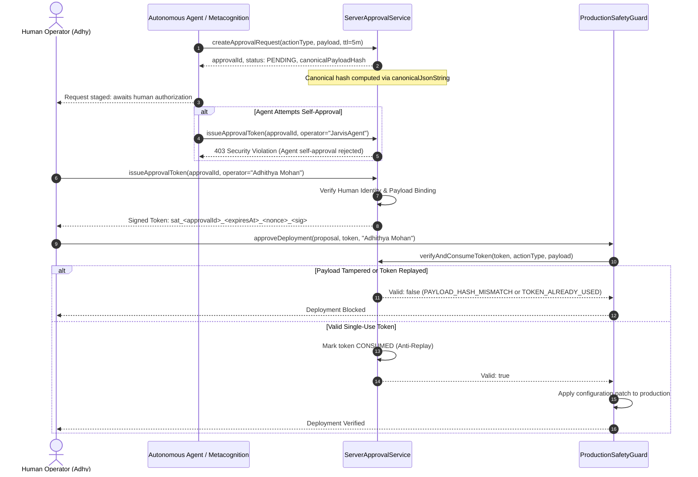
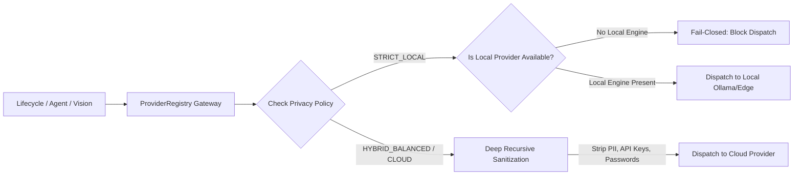
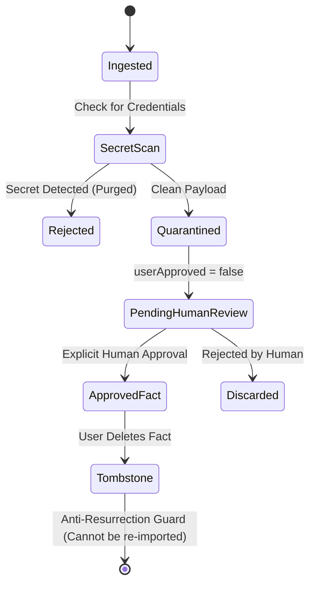

# MINI-ADHY — COMPLETE SECURITY ARCHITECTURE

**System**: Mini-Adhy Personal Cognitive Companion & Executive Intelligence  
**Author**: Adhithya Mohan (Creator & Principal Architect)  
**Classification**: Production Grade Security Architecture  
**Document Revision**: 3.0.0

---

## 1. Trust Boundaries & Risk Tiers

Mini-Adhy enforces an impenetrable four-tier risk taxonomy across all autonomous agent actions, cognitive learning modifications, and executive executions:

```
┌────────────────────────────────────────────────────────────────────────┐
│ PROHIBITED: rm -rf, drop database, secret exfiltration, eval/exec     │
├────────────────────────────────────────────────────────────────────────┤
│ L3 / HIGH_IMPACT: Production deployments, modifying persistent roots,  │
│                   credential changes, remote sync mutations            │
│                   (Requires ServerApprovalService cryptographically    │
│                    bound token from verified Creator)                  │
├────────────────────────────────────────────────────────────────────────┤
│ L2 / CONTROLLED: Code mutations in workspace, external API dispatch,   │
│                  state persistence, changing non-critical models       │
│                  (Requires confirmation token or owner session)        │
├────────────────────────────────────────────────────────────────────────┤
│ L0 - L1 / LOW_RISK: Telemetry readouts, status queries, sandboxed      │
│                     analysis, proposal drafting, VLM inspection        │
│                     (Autonomous execution permitted)                   │
└────────────────────────────────────────────────────────────────────────┘
```

---

## 2. Server-Authoritative Human Approval Flow (`ServerApprovalService`)

To eliminate self-manufactured agent approvals and client-side authorization bypasses, all high-impact actions must pass through `ServerApprovalService`:



### Invariants:
1. **Zero Self-Approval**: Agents matching `/agent|metacognition|jarvis|ultron|friday|edith|karen|jocasta|hermes|autonomous|dume/i` are forbidden from signing or issuing tokens.
2. **Single-Use**: Tokens are tracked in `consumedTokens` and cannot be replayed.
3. **Payload Binding**: The cryptographic token incorporates the canonical hash of the payload; modifying one character of the configuration invalidates the token.
4. **Time-To-Live**: Default 5-minute lifespan. Expired tokens are immediately invalidated.

---

## 3. Provider Privacy Gateway & Data Flow (`ProviderRegistry` & `HybridExecutionManager`)

All external reasoning and multimodal vision requests (including `VisualPerceptionEngine`, `RequestLifecycle`, and specialist agents) flow through `ProviderRegistry.generateWithFallback`:



- **Fail-Closed Execution**: If `STRICT_LOCAL` is active and cloud dispatch is attempted, the request is terminated with `privacyViolationBlocked: true`.
- **Recursive PII Sanitization**: Prompts and conversation history undergo recursive field scrubbing before any cloud egress.

---

## 4. Cryptographic Synchronization Protocol (`CognitiveSyncEngine`)

State synchronization between the browser client, desktop agent, and edge node is protected by authenticated, tamper-evident envelopes:

```json
{
  "syncId": "sync_1731154000_a8f9",
  "senderNodeId": "node_desktop_edge",
  "nodeId": "node_desktop_edge",
  "modelEpoch": 1,
  "sequenceNumber": 42,
  "nonce": "nonce_1731154000_9b2c3d",
  "timestamp": "2026-11-09T11:45:00.000Z",
  "expiresAt": "2026-11-09T11:50:00.000Z",
  "mutations": [...],
  "checksum": "d41d8cd98f00b204e9800998ecf8427e...",
  "signature": "d41d8cd98f00b204e9800998ecf8427e..."
}
```

- **Anti-Replay**: Nodes maintain a sliding window of nonces (`seenNonces`) and monotonically increasing sequence counters.
- **ACK Pruning**: Offline mutation queue items remain in `PENDING` status until an explicit cryptographic acknowledgment is received from the remote peer.

---

## 5. Memory Governance & Quarantine Lifecycle (`MemoryService`)

To defend against indirect prompt injection and unverified imported memory poisoning:



- **Forced Quarantine**: All imported records are forced to `userApproved = false` and `lifecycleStatus = 'QUARANTINED'`, regardless of claims inside the import payload.
- **Tombstones**: Deleted memory IDs are stored permanently in a tombstone set. Any subsequent sync or bundle import attempting to resurrect a tombstoned ID is rejected.

---

## 6. Serverless Authentication & CSRF Model (`api/auth.js`)

The API gateway at `/api/auth.js` enforces zero-trust serverless security:
- **Exact Origin Matching**: Only `adhy.tech`, `*.adhy.tech`, `*.vercel.app`, and local development origins (`localhost`, `127.0.0.1`) are permitted for state-changing POST requests.
- **Zero Token in URL**: Authorization tokens are strictly rejected from URL query parameters. Only `Authorization: Bearer <token>`, JSON body, and HttpOnly cookies are processed.
- **Cookie Hardening**: `Set-Cookie: adhy_session=...; Path=/; Max-Age=86400; HttpOnly; SameSite=Strict; Secure`.
- **IP Sliding Window Rate Limiting**: 5 failed login attempts trigger an immediate 2-minute IP lockdown.
- **Timing-Safe Equivalence**: Passcodes and HMAC signatures are evaluated using `crypto.timingSafeEqual` to eliminate side-channel timing leaks.

---

## 7. Durable Task Execution & Recovery Model (`ExecutionEngine` + `ResilientTaskManager`)

All multi-step DAG plans formulated by `TaskPlanner` are checkpointed in `ResilientTaskManager`:
- **Stage Checkpointing**: Before and after every DAG execution stage, state, intermediate outputs, and completed task IDs are committed to persistent storage.
- **Idempotency Defense**: Any consequential mutation bearing an `idempotencyToken` returns cached outcomes upon duplicate execution, preventing duplicate side effects.
- **Interrupted Plan Resumption**: `executionEngine.recoverInterruptedPlan(planId)` seamlessly reconstructs execution context from the last verified checkpoint.

